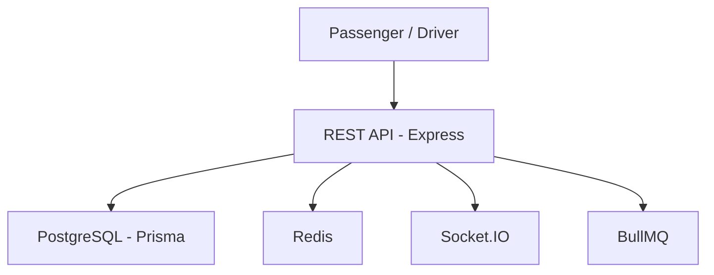

# RST-Tesla 🚖

**Share a seat. Split the fare.**

RST-Tesla is a ride-pooling web application built for Dhaka, Bangladesh. It allows passengers travelling along compatible routes to share a vehicle, reduce travel costs, and make better use of available seats.

Unlike traditional ride-booking systems, **both passengers and drivers can create ride pools**.

## How It Works

**1. Passenger-created pool**
- A passenger requests a ride and enables sharing.
- Other passengers travelling along a compatible route can request available seats.
- The driver accepts requests based on seat availability.

**2. Driver-created pool**
- A driver creates a pool for a planned route, such as Mirpur 1 → Mirpur 10.
- Passengers travelling along that route can request seats.
- The driver accepts passengers without exceeding vehicle capacity.

## Key Features

- Passenger and driver authentication
- Ride requests and shared ride pools
- Route-based passenger matching
- Seat availability and capacity management
- Individual fare calculation with pooling discounts
- Real-time ride status updates
- Ride cancellation and history
- Cash payment and post-ride Stripe payment

## Tech Stack

| Layer | Technology |
|---|---|
| Backend | Node.js, Express.js, TypeScript |
| Database | PostgreSQL |
| ORM | Prisma |
| Authentication | JWT, Cookies |
| Real-time | Socket.IO |
| Cache | Redis |
| Background Jobs | BullMQ |
| API | REST |
| Containerization | Docker |

## System Architecture



## Ride Lifecycle

`REQUESTED → ACCEPTED → DRIVER_ARRIVED → STARTED → COMPLETED`

Rides can also be cancelled when permitted.

## Running Locally

**Prerequisites:** Node.js, Docker and Docker Compose.

```bash
npm install
docker compose up -d
```

Configure environment variables using `.env.example` and run the required database migrations.

Stripe payment setup, webhook registration, test cards, and test/live credential separation are documented in [docs/stripe-payments.md](docs/stripe-payments.md).

## Project Scope

This project is an **MVP (Minimum Viable Product)** focused on reliable ride pooling, preventing seat overbooking, and maintaining consistent ride states.

Route matching currently uses predefined Dhaka service areas instead of full GPS-based routing.

## AI Usage

OpenSpec was used for implementation planning, and Codex assisted with code generation. Technical decisions and implementation remain the developer's responsibility.

---

**RST-Tesla — Making shared rides simpler in Dhaka.**
